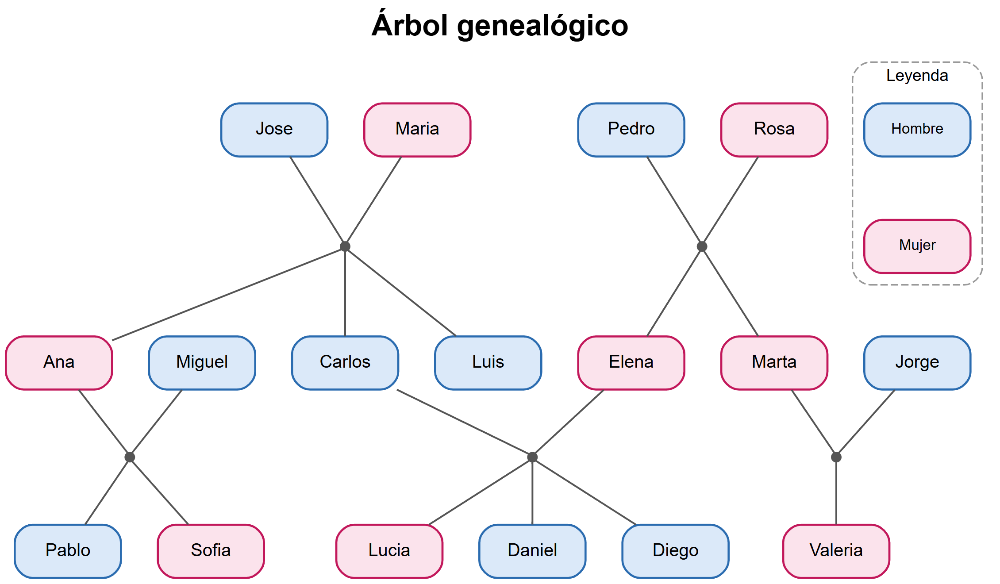
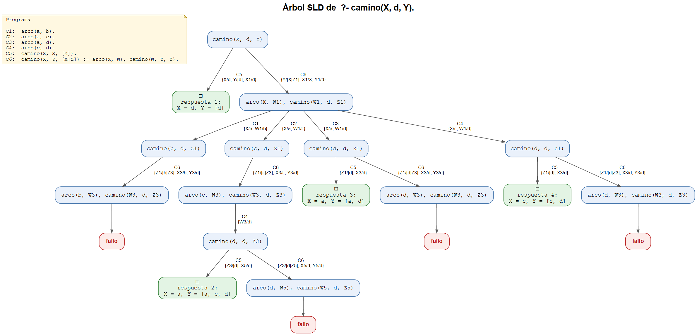

# Proyecto de Lógica Matemática: ejercicios en Prolog

Solución de los dos ejercicios del proyecto, escritos en Prolog y probados en
[SWISH](https://swish.swi-prolog.org/) (SWI-Prolog en el navegador).

| Ejercicio | Enunciado |
|-----------|-----------|
| 1 | Realizar el árbol genealógico propio, definiendo y utilizando las relaciones progenitor, mujer, hombre, padre, madre, hijo, hija, abuelo, abuela, hermano, hermana, tío, tía, sobrino y sobrina. |
| 2 | Dado el grafo dirigido `({a,b,c,d}, {(a,b),(a,c),(a,d),(c,d)})`, definir el predicado `camino` y graficar el árbol de búsqueda del objetivo `camino(X, d, Y)`. |

## Estructura

```
ejercicio1/
├── familia.pl               hechos, reglas y dibujo del árbol (DOT)
├── arbol_genealogico.png    árbol dibujado a partir de los hechos
└── capturas/                consultas ejecutadas en SWISH
ejercicio2/
├── camino.pl                grafo y predicado camino/3
├── arbol_sld.pl             construye el árbol de búsqueda (SLD) en DOT
├── arbol_sld.png            árbol de búsqueda de camino(X, d, Y)
└── capturas/                consultas ejecutadas en SWISH
```

## Ejercicio 1: árbol genealógico

### Hechos

- `progenitor(P, H)`: P es padre o madre de H.
- `hombre(X)` y `mujer(X)`.

Las personas se escriben como cadenas con su nombre completo, por ejemplo
`"Juan Francisco Montenegro Aguirre"`. El símbolo ✞ al final del nombre indica
que la persona ya falleció; forma parte del nombre, así que hay que escribirlo
igual en las consultas.

### Reglas

La convención de lectura es `rel(X, Y)`: "X es *rel* de Y".

| Regla | Definición |
|-------|------------|
| `padre(X, Y)`, `madre(X, Y)` | X es progenitor de Y y es hombre / mujer |
| `hijo(X, Y)`, `hija(X, Y)` | Y es progenitor de X y X es hombre / mujer |
| `abuelo(X, Y)`, `abuela(X, Y)` | X es padre / madre de un progenitor de Y |
| `hermanos(X, Y)` (auxiliar) | X e Y comparten al menos un progenitor |
| `hermano(X, Y)`, `hermana(X, Y)` | X e Y son hermanos y X es hombre / mujer |
| `tio(X, Y)`, `tia(X, Y)` | X es hermano / hermana de un progenitor de Y |
| `sobrino(X, Y)`, `sobrina(X, Y)` | X es hijo / hija de un hermano(a) de Y |

`hermanos/2` incluye a los medios hermanos (basta con compartir uno de los dos
progenitores). Así, un medio hermano por parte de papá cuenta como hermano y sus
hijos cuentan como sobrinos. `distinct/2` evita que los hermanos completos
aparezcan dos veces (una por el padre y otra por la madre).

### Cómo ejecutarlo en SWISH

1. Abrir <https://swish.swi-prolog.org/>, elegir **Program** y pegar el
   contenido de `ejercicio1/familia.pl`.
2. Con la casilla **table results** marcada, ejecutar consultas como:

   ```prolog
   ?- padre(X, Y).
   ?- abuela(X, "Juan Francisco Montenegro Aguirre").
   ?- tio(X, "Juan Francisco Montenegro Aguirre").
   ?- sobrina(X, Y).
   ```

3. Para dibujar el árbol, desmarcar **table results** y ejecutar:

   ```prolog
   ?- arbol_familia(_Dot), Arbol = dot(_Dot).
   ```

   `arbol_familia/1` genera el árbol en lenguaje DOT a partir de los hechos, y la
   directiva `:- use_rendering(graphviz).` del inicio del programa hace que
   SWISH lo dibuje.

En el árbol, cada pareja baja a un punto del que salen sus hijos; los hombres
van en azul y las mujeres en rosa.



### Capturas

| Archivo | Consultas |
|---------|-----------|
| `ej1_00_hechos.png` | `progenitor(X, "Juan Francisco Montenegro Aguirre"), hombre(X)` y `..., mujer(X)` |
| `ej1_01_padre_madre.png` | `padre(X, Y)` y `madre(X, Y)` |
| `ej1_02_hijo_hija.png` | `hijo(X, Y)` y `hija(X, Y)` |
| `ej1_03_abuelo_abuela.png` | `abuelo(X, Y)` y `abuela(X, Y)` |
| `ej1_04_hermano_hermana.png` | `hermano(X, Y)` y `hermana(X, Y)` |
| `ej1_05_tio_tia.png` | `tio(X, Y)` y `tia(X, Y)` |
| `ej1_06_sobrino_sobrina.png` | `sobrino(X, Y)` y `sobrina(X, Y)` |
| `ej1_07_arbol_swish.png` | `arbol_familia(_Dot), Arbol = dot(_Dot)` |

## Ejercicio 2: caminos en un grafo dirigido

```prolog
arco(a, b).
arco(a, c).
arco(a, d).
arco(c, d).

% camino(X, Y, C): C es la lista de vértices de un camino de X a Y
camino(X, X, [X]).
camino(X, Y, [X|Z]) :- arco(X, W), camino(W, Y, Z).
```

La consulta pedida da cuatro respuestas:

```prolog
?- camino(X, d, Y).
X = d, Y = [d] ;
X = a, Y = [a, c, d] ;
X = a, Y = [a, d] ;
X = c, Y = [c, d].
```

### Árbol de búsqueda

En lugar de SldDraw, `arbol_sld.pl` usa un meta-intérprete que reproduce la
resolución SLD de Prolog: siempre resuelve primero la meta de más a la izquierda
y prueba las cláusulas en orden. Así construye el árbol completo, incluidas las
ramas que fallan, y lo devuelve en DOT. En cada arista se indica la cláusula
usada (C1 a C6) y el unificador; las variables de cada paso se renombran con el
número de nivel (`X1`, `W1`, `Z3`, ...).

Para verlo en SWISH, pegar `ejercicio2/arbol_sld.pl`, agregar
`:- use_rendering(graphviz).` al inicio, desmarcar **table results** y ejecutar:

```prolog
?- programa_camino(_P), arbol_sld(_P, "camino(X, d, Y)", _Dot), Arbol = dot(_Dot).
```

El árbol tiene las 4 respuestas (en verde) y 4 ramas de fallo (en rojo).



### Capturas

| Archivo | Consulta |
|---------|----------|
| `ej2_01_camino.png` | `camino(X, d, Y)` |
| `ej2_02_arbol_swish.png` | `programa_camino(_P), arbol_sld(_P, "camino(X, d, Y)", _Dot), Arbol = dot(_Dot)` |

## Ejecutar en SWI-Prolog local

Los programas también cargan en SWI-Prolog de escritorio. Fuera de SWISH no
existe `use_rendering/1`, así que la directiva de `familia.pl` muestra un error
al cargar, pero el resto del programa carga normalmente (se puede comentar esa
línea). Para obtener las imágenes, se imprime el DOT, se guarda en un archivo
`arbol.dot` y se dibuja con [Graphviz](https://graphviz.org/):

```prolog
?- arbol_familia(Dot), write(Dot).
?- programa_camino(P), arbol_sld(P, "camino(X, d, Y)", Dot), write(Dot).
```

```sh
dot -Tpng arbol.dot -o arbol.png
```
